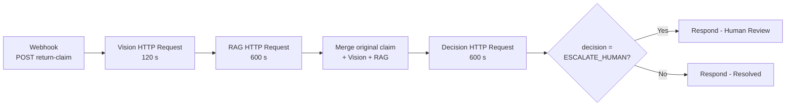

# AI Return Auditor — Project Report

**Report date:** 18 October 2026  
**Project:** AI Return Auditor  
**Purpose:** Describe the implemented application, its agent workflow, n8n orchestration, safeguards, deployment, and current limitations.

> This report describes the code and workflow export currently in the project. An exported n8n workflow is initially inactive; its activation state in a running n8n instance is managed separately.

## 1. Executive summary

AI Return Auditor is a prototype for reviewing e-commerce return claims using a product image, a customer description, retrieved return-policy passages, and order details. A Streamlit client collects the claim. An n8n workflow orchestrates calls to a FastAPI service, which runs the Python agent code.

The processing sequence is:

1. **Photo review:** Gemini analyzes the image alongside the customer description and returns typed visual findings.
2. **Policy matching:** The retrieval pipeline searches a local policy corpus using the description and visual findings.
3. **Decision consensus:** Five concurrent Groq model samples recommend an outcome. A voting engine applies consensus and high-value rules.
4. **Compliance check:** A local Ollama model independently checks the consensus against the claim, findings, and policies. A flagged result is changed to human review.
5. **Response:** n8n returns the stage results and decision to the Streamlit client.

The LLM Judge’s detailed report is written to `llm_judge_verdict.json` and is not included in the customer-facing UI response. The receipt/OCR agent has not been connected. The current UI provides customer-facing updates, but it is not a staff review queue or a production return-processing system.

## 2. Goals and scope

### Goals

- Accept a return claim with order information, item price, description, and product image.
- Compare the visual evidence with the customer’s description.
- Retrieve policy passages relevant to the claim.
- Produce an evidence-based recommendation with disagreement and high-value escalation safeguards.
- Make the processing stages visible to the customer.
- Add an independent, local compliance check before returning a decision.

### Current outcomes

The decision model can return:

- `APPROVE_REFUND`
- `APPROVE_RETURN`
- `REJECT`
- `ESCALATE_HUMAN`

The application should be understood as a decision-support prototype. The automated recommendation is not proof that a refund, replacement, return label, or payment transaction has been executed.

### Out of scope / not yet implemented

- Receipt image OCR and adding extracted receipt text to the customer claim.
- Connecting to a real order-management, payment, refund, or returns system.
- Persistent, authenticated staff review and resolution of escalated cases.
- Production identity, access-control, deployment, monitoring, and retention controls.

## 3. Architecture

```mermaid
flowchart LR
    C[Customer] --> UI[Streamlit client UI]
    UI -->|POST JSON + base64 image| WH[n8n Webhook<br/>POST return-claim]
    WH --> V[FastAPI /analyze/vision<br/>Gemini Vision]
    V --> R[FastAPI /analyze/rag<br/>Policy retrieval]
    R --> M[n8n Merge claim + findings + policies]
    M --> D[FastAPI /analyze/decision<br/>Groq samples + consensus + Ollama Judge]
    D --> IF{Decision is<br/>ESCALATE_HUMAN?}
    IF -->|Yes| HR[Respond - Human Review]
    IF -->|No| OK[Respond - Resolved]
    HR --> UI
    OK --> UI
    UI -. stage polling .-> P[FastAPI /api/audit-progress/{request_id}]
```

The Streamlit UI sends the claim to n8n. It also polls FastAPI for stage updates, so the interface can show progress while n8n orchestrates the agent calls. The UI does not directly invoke each agent.

The backend also retains a separate, legacy full-pipeline API at `/api/audit-pipeline` and `/api/audit-pipeline/stream`. The current UI’s n8n submission path does not use those routes.

## 4. Application components

### 4.1 Customer interface

[`appUI.py`](./appUI.py) implements a Streamlit client with:

- A customer-oriented landing page explaining the review process.
- A return form for order number, item name, item price, customer description, and an image.
- Base64 encoding of the uploaded image and a JSON request to the n8n webhook.
- Progress display for claim receipt, photo review, policy matching, and recommendation.
- A result page showing the decision, customer message, photo findings, policy passages, and a concise rationale.
- Local persistence of audit records in `audit_log.json`; this is not a remote account system.

The raw judge report is not added to the pipeline response or displayed by the result page.

### 4.2 FastAPI backend

[`appBack.py`](./appBack.py) hosts the agent endpoints called by n8n:

| Endpoint | Method | Input / purpose | Output |
|---|---|---|---|
| `/health` | GET | Backend liveness check. | `{"status":"ok"}` |
| `/api/audit-progress/{request_id}` | GET | Progress recorded by the stage endpoints. | Stage states and user-safe messages. |
| `/analyze/vision` | POST | `request_id`, base64 image, customer description. | Structured visual findings. |
| `/analyze/rag` | POST | `request_id`, customer description, Vision JSON. | Query, applicable passages, source IDs, retrieval status. |
| `/analyze/decision` | POST | Claim fields, Vision JSON, RAG JSON. | Consensus and compliance-reviewed decision. |

The request models use Pydantic validation for required fields and non-negative item value. The Vision endpoint decodes and validates the image before passing it to the agent. Agent work is moved off the async event loop with `asyncio.to_thread`.

### 4.3 Vision analysis

[`agents/vision_agent.py`](./agents/vision_agent.py) uses the Google Gemini client and a Pydantic `VisionAnalysis` model. It considers both the image and customer description, but is instructed to report visual evidence only—not determine policy eligibility.

The structured output includes product category/type, damage type/location/severity, confidence, visual evidence, consistency with the description, and uncertainty. Severity is expected to be Low, Medium, High, None, or Unknown. The configured `GEMINI_VISION_MODEL` defaults in code to `gemini-3.8-flash`; if a model call raises, fallback attempts use `gemini-3.7-flash` and `gemini-3.6-flash`.

The prompt is [`prompts/vision_agent_v1.txt`](./prompts/vision_agent_v1.txt).

### 4.4 Policy retrieval

[`agents/rag_agent.py`](./agents/rag_agent.py) runs query expansion, hybrid retrieval, deduplication, and reranking. The processed policy corpus is [`data/knowledge_base/processed/PDFoutput2.json`](./data/knowledge_base/processed/PDFoutput2.json), containing 15 chunks at the time of this report; its source PDF is in `data/knowledge_base/raw/`.

The retrieval path is:

1. Build a query from the original customer description and Vision JSON.
2. Ask Groq to create up to two additional query variants, preserving the original query as well.
3. For each query, perform dense and sparse retrieval.
4. Fuse the ranked results using weighted reciprocal-rank fusion.
5. Deduplicate by chunk ID, keeping the best hybrid score across query variants.
6. Rerank the candidate passages against the original combined query and return the top four.

The underlying components are:

| Component | Current implementation |
|---|---|
| Query expansion | Groq model `qwen/qwen3.8-27b`; original query plus up to two rewrites. |
| Dense retrieval | `BAAI/bge-m3` embeddings and cosine similarity. |
| Sparse retrieval | BM25 with NLTK Porter stemming and a small stop-word list. |
| Rank fusion | Weighted reciprocal-rank fusion; dense weight `0.4`, sparse weight `0.6`, `rrf_k=20`. |
| Reranking | `BAAI/bge-reranker-v2-m3`, returning up to four passages. |

The embedding and reranker models are loaded lazily and cached in the running Python process. First-use retrieval may therefore take substantially longer than subsequent calls, depending on model downloads and local hardware.

### 4.5 Self-consistency Decision Agent

[`agents/decision_agent.py`](./agents/decision_agent.py) formats the original claim and retrieved policies as JSON locally, then runs the self-consistency process defined in [`SCprompting/`](./SCprompting/).

#### Sampling

- Model: `openai/gpt-oss-20b` through Groq.
- Number of samples: **5**.
- Temperature: **0.7**.
- The same evidence and system prompt are sent to each sample.
- Calls are run concurrently using the async Groq client.
- JSON mode is requested. The prompt asks for a decision, short evidence-based rationale, confidence score, and customer instructions.

The prompt’s allowed decision labels and output shape are in [`SCprompting/prompt_templates.py`](./SCprompting/prompt_templates.py); model parameters are in [`SCprompting/config.py`](./SCprompting/config.py).

#### Voting and decision guardrails

[`SCprompting/consensus_engine.py`](./SCprompting/consensus_engine.py) excludes samples with an `error` key or without a `decision` key, then selects the most common decision.

- Minimum agreement: **60%** of valid samples.
- Five valid samples therefore require at least three votes for a leading decision.
- An agreement ratio below 60% escalates to `ESCALATE_HUMAN`.
- A leading `ESCALATE_HUMAN` decision stays escalated.
- An item value **greater than $500** is escalated. Exactly $500 does not meet this strict `>` condition.
- On a completed consensus, `confidence` is the proportion of valid samples that voted for the winning decision. It is not an average of each response’s `confidence_score`.
- The first valid winning sample supplies the rationale and customer instructions; those fields are not synthesized across samples.

If all model samples fail, sample generation raises an error instead of treating failed outputs as a completed decision.

### 4.6 Local LLM Judge

[`agents/llm_judge.py`](./agents/llm_judge.py) runs after the consensus engine. It sends the consensus decision, original claim, Vision findings, and retrieved policies to a local Ollama chat endpoint.

Current configuration:

- Model: `qwen2.5:7b`.
- Default local endpoint: `http://127.0.0.1:11434/api/chat`.
- Request timeout: 300 seconds unless `OLLAMA_TIMEOUT_SECONDS` overrides it.
- Structured JSON output is requested using a JSON schema; temperature is `0.15`, `top_p` is `0.9`, repeat penalty is `1.1`, maximum output is 300 tokens, and seed is 42.

The judge checks for unsupported/hallucinated evidence, direct policy violations, and dangerous contradictions. A flagged verdict changes the returned decision to `ESCALATE_HUMAN`. A PASS leaves the consensus result unchanged.

Each run atomically overwrites [`llm_judge_verdict.json`](./llm_judge_verdict.json), including the selected model, consensus and final decisions, flags, findings, and rationale. This report is not placed in the customer-facing response.

If the model is not configured, Ollama cannot be reached, the response is invalid, or the report cannot be written, the judge records an error and raises. In that case, the decision endpoint fails with an error and no unchecked recommendation is returned. This is fail-closed behavior; it is not the same as returning a successful human-escalation result.

## 5. n8n workflow

The complete importable workflow is [`n8n/workflow.json`](./n8n/workflow.json). Its important configuration is summarized below, and the complete JSON export is included later in this report.

### Trigger and payload

- Webhook method: `POST`.
- Path: `return-claim`.
- Production URL: `http://localhost:5678/webhook/return-claim` by default in the UI.
- The workflow export is inactive (`"active": false`) until activated in n8n.
- Claim JSON fields: `request_id`, `order_id`, `product_name`, `item_value`, `user_description`, and `image_base64`.

### Nodes and connections

| Order | n8n node | Responsibility |
|---:|---|---|
| 1 | Webhook - Receive Claim | Receives a submitted claim and starts the execution. |
| 2 | Agent 1 - Vision Agent | Calls `POST http://host.docker.internal:8000/analyze/vision` with the original description and base64 photo. Timeout: 120 seconds. |
| 3 | Agent 2 - RAG Agent | Calls `POST http://host.docker.internal:8000/analyze/rag` with the original description and Vision JSON. Timeout: 600 seconds. |
| 4 | Merge - Vision + RAG + Claim | Combines original order/claim fields, Vision output, and RAG output. |
| 5 | Agent 3 - Decision Agent | Calls `POST http://host.docker.internal:8000/analyze/decision`. The endpoint runs Groq consensus plus the local Ollama Judge. Timeout: 600 seconds. |
| 6 | IF - Human Review Required | Checks whether `decision` equals `ESCALATE_HUMAN`. |
| 7a | Respond - Human Review | Returns an escalated status and complete pipeline trace. |
| 7b | Respond - Resolved | Returns a success status and complete pipeline trace. |



Both response branches return `pipeline_trace` with `vision_agent`, `rag_agent`, and `decision_output`. The HTTP response code is 200 on either business outcome; the status in the JSON distinguishes escalation from resolution.

**Important:** Editing the local JSON file does not update a workflow already imported into n8n. Re-import or edit the workflow in n8n, save/publish it, and activate it for the production webhook. With n8n running under Docker Desktop, `host.docker.internal` is used so its container can reach FastAPI on the host.

The n8n IF branch currently returns a response for human review but does not create a staffed review ticket, notify a reviewer, or persist a reviewer’s outcome.

### Complete workflow export

This is the workflow snapshot bundled with this report; [`n8n/workflow.json`](./n8n/workflow.json) is the canonical file to import.

```json
{
  "name": "AI Return Auditor - Full Pipeline",
  "nodes": [
    {
      "parameters": {
        "httpMethod": "POST",
        "path": "return-claim",
        "responseMode": "responseNode",
        "options": {}
      },
      "id": "node_webhook",
      "name": "Webhook - Receive Claim",
      "type": "n8n-nodes-base.webhook",
      "typeVersion": 2,
      "position": [200, 300],
      "notes": "Receives JSON with request_id, image_base64, user_description, order_id, product_name, and item_value."
    },
    {
      "parameters": {
        "method": "POST",
        "url": "http://host.docker.internal:8000/analyze/vision",
        "sendBody": true,
        "specifyBody": "json",
        "jsonBody": "={{ JSON.stringify({ request_id: $('Webhook - Receive Claim').item.json.body.request_id, image_base64: $('Webhook - Receive Claim').item.json.body.image_base64, customer_description: $('Webhook - Receive Claim').item.json.body.user_description }) }}",
        "options": {
          "timeout": 120000
        }
      },
      "id": "node_vision",
      "name": "Agent 1 - Vision Agent",
      "type": "n8n-nodes-base.httpRequest",
      "typeVersion": 4.2,
      "position": [460, 300],
      "notes": "Analyzes the original product image and description."
    },
    {
      "parameters": {
        "method": "POST",
        "url": "http://host.docker.internal:8000/analyze/rag",
        "sendBody": true,
        "specifyBody": "json",
        "jsonBody": "={{ JSON.stringify({ request_id: $('Webhook - Receive Claim').item.json.body.request_id, customer_description: $('Webhook - Receive Claim').item.json.body.user_description, vision_agent_json: $('Agent 1 - Vision Agent').item.json }) }}",
        "options": {
          "timeout": 600000
        }
      },
      "id": "node_rag",
      "name": "Agent 2 - RAG Agent",
      "type": "n8n-nodes-base.httpRequest",
      "typeVersion": 4.2,
      "position": [720, 300],
      "notes": "Retrieves policy passages using both the original description and Vision JSON."
    },
    {
      "parameters": {
        "jsCode": "const claim = $('Webhook - Receive Claim').item.json.body;\nconst vision = $('Agent 1 - Vision Agent').item.json;\nconst rag = $('Agent 2 - RAG Agent').item.json;\n\nreturn [{ json: {\n  request_id: claim.request_id,\n  order_id: claim.order_id,\n  product_name: claim.product_name || '',\n  item_value: Number(claim.item_value || 0),\n  original_user_description: claim.user_description,\n  vision_agent_json: vision,\n  rag_agent_json: rag\n} }];"
      },
      "id": "node_merge",
      "name": "Merge - Vision + RAG + Claim",
      "type": "n8n-nodes-base.code",
      "typeVersion": 2,
      "position": [980, 300],
      "notes": "Passes the original claim, vision evidence, and retrieved policies to the decision agent."
    },
    {
      "parameters": {
        "method": "POST",
        "url": "http://host.docker.internal:8000/analyze/decision",
        "sendBody": true,
        "specifyBody": "json",
        "jsonBody": "={{ JSON.stringify({ request_id: $json.request_id, order_id: $json.order_id, product_name: $json.product_name, item_value: $json.item_value, original_user_description: $json.original_user_description, vision_agent_json: $json.vision_agent_json, rag_agent_json: $json.rag_agent_json }) }}",
        "options": {
          "timeout": 600000
        }
      },
      "id": "node_decision",
      "name": "Agent 3 - Decision Agent",
      "type": "n8n-nodes-base.httpRequest",
      "typeVersion": 4.2,
      "position": [1240, 300],
      "notes": "Runs self-consistency, business guardrails, and the local Ollama compliance judge before returning a decision."
    },
    {
      "parameters": {
        "conditions": {
          "options": {
            "caseSensitive": false,
            "leftValue": "",
            "typeValidation": "loose"
          },
          "conditions": [
            {
              "id": "condition_human_review",
              "leftValue": "={{ $json.decision }}",
              "rightValue": "ESCALATE_HUMAN",
              "operator": {
                "type": "string",
                "operation": "equals"
              }
            }
          ],
          "combinator": "and"
        },
        "options": {}
      },
      "id": "node_if",
      "name": "IF - Human Review Required",
      "type": "n8n-nodes-base.if",
      "typeVersion": 2,
      "position": [1500, 300]
    },
    {
      "parameters": {
        "respondWith": "json",
        "responseBody": "={{ JSON.stringify({ status: 'success', pipeline_trace: { vision_agent: $('Agent 1 - Vision Agent').item.json, rag_agent: $('Agent 2 - RAG Agent').item.json, decision_output: $('Agent 3 - Decision Agent').item.json } }) }}",
        "options": {
          "responseCode": 200
        }
      },
      "id": "node_respond_resolved",
      "name": "Respond - Resolved",
      "type": "n8n-nodes-base.respondToWebhook",
      "typeVersion": 1,
      "position": [1760, 440]
    },
    {
      "parameters": {
        "respondWith": "json",
        "responseBody": "={{ JSON.stringify({ status: 'escalated', pipeline_trace: { vision_agent: $('Agent 1 - Vision Agent').item.json, rag_agent: $('Agent 2 - RAG Agent').item.json, decision_output: $('Agent 3 - Decision Agent').item.json } }) }}",
        "options": {
          "responseCode": 200
        }
      },
      "id": "node_respond_review",
      "name": "Respond - Human Review",
      "type": "n8n-nodes-base.respondToWebhook",
      "typeVersion": 1,
      "position": [1760, 160]
    }
  ],
  "connections": {
    "Webhook - Receive Claim": {
      "main": [
        [
          {
            "node": "Agent 1 - Vision Agent",
            "type": "main",
            "index": 0
          }
        ]
      ]
    },
    "Agent 1 - Vision Agent": {
      "main": [
        [
          {
            "node": "Agent 2 - RAG Agent",
            "type": "main",
            "index": 0
          }
        ]
      ]
    },
    "Agent 2 - RAG Agent": {
      "main": [
        [
          {
            "node": "Merge - Vision + RAG + Claim",
            "type": "main",
            "index": 0
          }
        ]
      ]
    },
    "Merge - Vision + RAG + Claim": {
      "main": [
        [
          {
            "node": "Agent 3 - Decision Agent",
            "type": "main",
            "index": 0
          }
        ]
      ]
    },
    "Agent 3 - Decision Agent": {
      "main": [
        [
          {
            "node": "IF - Human Review Required",
            "type": "main",
            "index": 0
          }
        ]
      ]
    },
    "IF - Human Review Required": {
      "main": [
        [
          {
            "node": "Respond - Human Review",
            "type": "main",
            "index": 0
          }
        ],
        [
          {
            "node": "Respond - Resolved",
            "type": "main",
            "index": 0
          }
        ]
      ]
    }
  },
  "active": false,
  "settings": {
    "executionOrder": "v1"
  },
  "versionId": "1",
  "meta": {
    "templateCredsSetupCompleted": true
  },
  "tags": []
}
```

## 6. Data flow and response shape

The customer UI submits a JSON body containing order number, item name, price, user description, request ID, and base64-encoded image. The Webhook node creates the orchestration execution:

```text
UI JSON claim
  → Vision request {request_id, image_base64, customer_description}
  → RAG request {request_id, customer_description, vision_agent_json}
  → Merge {claim + vision_agent_json + rag_agent_json}
  → Decision request {claim fields + vision_agent_json + rag_agent_json}
  → webhook JSON response {status, pipeline_trace}
```

The pipeline trace contains:

- `vision_agent`: structured photo findings.
- `rag_agent`: query, relevant policies, source IDs, and retrieval status.
- `decision_output`: consensus result after the compliance check.

The exact Pydantic request schemas are defined near the beginning of [`appBack.py`](./appBack.py). The UI polls `/api/audit-progress/{request_id}` during workflow execution and sanitizes internal stage messages into customer-friendly progress text.

## 7. Configuration and running locally

### Required software/services

- Python environment with packages from [`requirements.txt`](./requirements.txt).
- Gemini API access for photo analysis.
- Groq API access for RAG query expansion and decision samples.
- Ollama installed and running locally with `qwen2.5:7b` available.
- n8n running, with this workflow imported and activated for production-webhook use.

### Environment variables

Store secrets in an untracked `.env` file in the project directory. Never place real credentials in this report or commit them.

| Variable | Purpose | Current/default value |
|---|---|---|
| `GEMINI_API_KEY` | Vision service authentication. | Required secret. |
| `GEMINI_VISION_MODEL` | Preferred Gemini Vision model. | Defaults in code to `gemini-3.8-flash`. |
| `GROQ_API_KEY` | RAG query expansion and decision model authentication. | Required secret. |
| `OLLAMA_MODEL` | Local judge model name. | `qwen2.5:7b`. |
| `OLLAMA_BASE_URL` | Local Ollama API base URL. | `http://127.0.0.1:11434` in documented setup; must resolve to loopback under current judge validation. |
| `OLLAMA_TIMEOUT_SECONDS` | Maximum wait for one judge request. | `300`. |
| `N8N_WEBHOOK_URL` | Webhook called by Streamlit. | `http://localhost:5678/webhook/return-claim`. |
| `AUDIT_BACKEND_URL` | FastAPI address used for progress polling. | `http://127.0.0.1:8000`. |
| `AUDIT_LOG_PATH` | Local audit history path. | `audit_log.json`. |

### Start the services

From the `AI_Return_Auditor` directory, run each service in its own terminal:

```powershell
uvicorn appBack:app --reload --host 0.0.0.0 --port 8000
streamlit run appUI.py
```

Also ensure Ollama is running and n8n is running with the workflow active. If testing an inactive workflow in the n8n editor, use its `/webhook-test/return-claim` URL only while the Webhook node is listening for a test event.

FastAPI binds to all local interfaces so Docker Desktop’s n8n container can reach it through `host.docker.internal`. This is a development configuration; use firewall controls and do not expose this service to untrusted networks.

### Timeouts

- Vision n8n HTTP node: 120,000 ms (2 minutes).
- RAG n8n HTTP node: 600,000 ms (10 minutes).
- Decision n8n HTTP node: 600,000 ms (10 minutes).
- Streamlit’s overall webhook request timeout: 1,800 seconds (30 minutes).
- Ollama judge request timeout: 300 seconds by default.

An already-imported n8n workflow does not inherit edits to the local `workflow.json`; verify the node settings in n8n after importing or editing it.

## 8. Security, privacy, and reliability considerations

### Implemented safeguards

- `.env` is listed in the project `.gitignore`.
- Input request fields are validated with Pydantic.
- Uploaded images are base64-decoded and validated as readable images before Vision processing.
- The judge accepts only a loopback Ollama URL, helping keep claim data on the local machine.
- The judge requests schema-constrained JSON and validates the returned booleans, findings, and rationale.
- Judge errors do not permit an unchecked decision to be returned.
- The judge report is stored separately from the customer-facing response.

### Remaining risks and recommended improvements

- **No authentication on FastAPI stage endpoints:** Anyone who can reach the backend may invoke costly agent calls. Add a shared service credential between n8n and FastAPI, stored in n8n credentials and `.env`, never in the browser client.
- **Network exposure:** FastAPI binds to `0.0.0.0`. Restrict it with host firewall rules and keep it off public networks unless protected by a deployment-grade network boundary and HTTPS.
- **No explicit upload size or image-dimension limit:** Add limits before decoding/processing to reduce memory exhaustion risk.
- **Sensitive local files:** `audit_log.json` and `llm_judge_verdict.json` contain claim-related or judge data. The current `.gitignore` does not list these files. Add them to ignore/retention controls before using real customer data or pushing the project to a repository.
- **Local UI history is not access-controlled:** Audit records are stored as a local JSON file, not segregated per customer or protected by accounts.
- **Prompt injection exposure:** Customer text and retrieved document text are untrusted. Keep them explicitly framed as evidence, not instructions, in each model prompt; test adversarial inputs.
- **Model verdicts are not guarantees:** The self-consistency panel and the Judge are both probabilistic. Retain human oversight and evaluate false approvals, false escalations, and policy coverage.
- **Concurrent verdict writes:** The verdict file is a single overwrite target as requested. Concurrent claims can overwrite each other’s report; use a lock or per-request report files if parallel production traffic is introduced.
- **No rate limit or bounded audit concurrency:** Add request limits and concurrency controls before deployment.
- **Timeouts permit long work but do not speed it up:** First-run retrieval can be slow because of model loading; monitor each stage and profile local CPU/RAM/GPU use.

## 9. Testing and verification

### Existing validation evidence

- `test_vision.py` is a manual Vision test script that calls Gemini and expects a local `glasses.PNG` image; it is not an automated end-to-end test suite.
- The project’s earlier implementation checks used mocked FastAPI stage calls to verify Vision → RAG → Decision payload flow and progress tracking.
- The UI has been checked with Streamlit AppTest for startup, customer navigation, and result rendering.
- Python compilation and Pylance checks have been run on the changed application/agent code.
- The Ollama Judge has been exercised with mocked PASS, override, report-rewrite, and failure scenarios, and with a real local `qwen2.5:7b` request.
- A live end-to-end n8n execution depends on the workflow actually imported and activated in the user’s n8n instance. The exported file alone cannot prove that deployment state.

### Recommended repeatable end-to-end test

1. Confirm `/health` on FastAPI and Ollama are reachable.
2. Confirm n8n’s imported workflow is active and each HTTP Request node uses `host.docker.internal:8000`.
3. Submit a test claim from the Streamlit UI.
4. Confirm the n8n execution reaches both response nodes only after the Vision, RAG, Merge, Decision, and IF nodes complete.
5. Verify the customer response contains the pipeline trace but no judge findings/rationale.
6. Verify the local judge report is overwritten and its final decision matches the returned result or records an explicit failure.

## 10. Current limitations and project status

| Area | Current status |
|---|---|
| Customer-facing Streamlit flow | Implemented. |
| Gemini image/description analysis | Implemented with structured Pydantic output and fallback model names. |
| Policy retrieval | Implemented with query expansion, dense/BM25 fusion, and reranking. |
| Self-consistency decision logic | Implemented with five samples, majority voting, and the `$500` high-value guardrail. |
| Local Ollama compliance judge | Implemented; configured model is `qwen2.5:7b`. |
| Private judge verdict file | Implemented as an overwrite-per-run JSON report, but currently has no per-request isolation. |
| n8n orchestration export | Implemented in `n8n/workflow.json`; must be imported and activated in n8n. |
| Human review response branch | Returns an escalation response; it does not yet route to a real reviewer or record their outcome. |
| Receipt OCR agent | Not integrated. |
| Production security/operations | Not complete; see Section 8. |
| Automated full workflow tests | Not currently present as a repeatable test suite. |

## 11. Actual project layout

```text
AI_Return_Auditor/
├── agents/
│   ├── decision_agent.py
│   ├── llm_judge.py
│   ├── rag_agent.py
│   └── vision_agent.py
├── data/
│   └── knowledge_base/
│       ├── processed/PDFoutput2.json
│       └── raw/DLprojectExample.pdf
├── n8n/
│   └── workflow.json
├── prompts/
│   └── vision_agent_v1.txt
├── rag/
│   └── src/
│       ├── embeddings.py
│       └── retrieval/
├── SCprompting/
│   ├── config.py
│   ├── consensus_engine.py
│   ├── model_runner.py
│   └── prompt_templates.py
├── appBack.py
├── appUI.py
├── audit_log.json
├── llm_judge_verdict.json
├── requirements.txt
└── test_vision.py
```

## 12. Conclusion

The implemented system demonstrates an end-to-end, automation-orchestrated approach to return-claim review: a customer-facing interface submits a claim to n8n, the workflow calls specialized backend stages, consensus reduces reliance on one decision sample, and a local compliance judge provides a final safety check before the recommendation is returned.

The strongest next steps are to add authenticated internal endpoints, protect and limit claim data, build automated evaluation tests, and connect escalations to a genuine human review process. Receipt OCR remains a separate planned addition.
